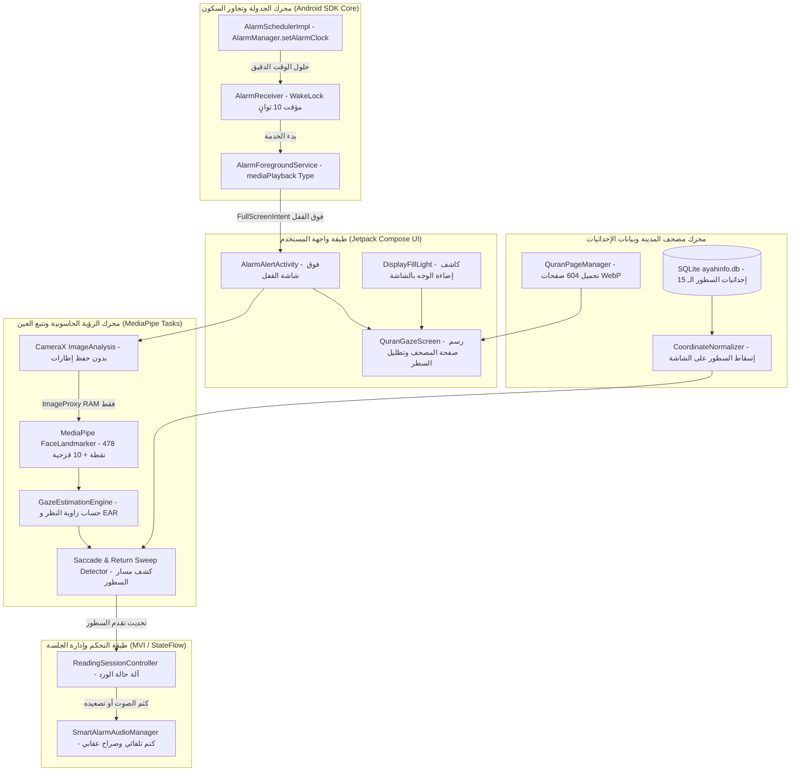
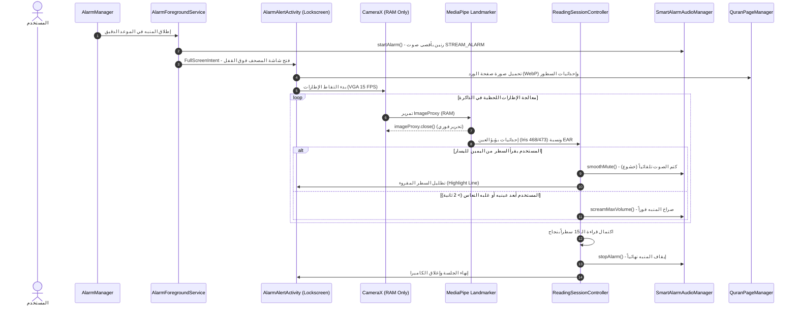

# وثيقة البنية المعمارية (Architecture Blueprint)
## مشروع: منبه القرآن الكريم (Quran Alarm)
**الإصدار:** 1.0.0  
**الحالة:** معتمدة ومجمدة (Frozen Baseline)  
**النمط المعماري:** Clean Architecture + MVI (Model-View-Intent) + Air-Gapped Local Vision Engine  

---

## 1. النظرة المعمارية العامة (Architectural Overview)

صُمم نظام **منبه القرآن الكريم** ليعمل كنظام مغلق ومعزول محلياً بالكامل (Air-Gapped Embedded Android System) بدون أي اعتماديات سحابية أو شبكية، مع تقسيم النظام إلى طبقات ومكونات مستقلة تحقق مبادئ المسؤولية الواحدة (Single Responsibility) وسهولة الاختبار (Testability).



---

## 2. تفكيك المكونات والمحركات الرئيسية (Core Components)

### أ. محرك الجدولة والتنبيه فائق الدقة (Alarm & Scheduling Engine)
* **المسؤولية:** ضمان رنين المنبه في الموعد المحدد بالثانية، حتى لو كان الجهاز في أعمق درجات توفير الطاقة (Doze Mode)، أو أُعيد تشغيله.
* **المكونات:**
  1. `AlarmScheduler`: واجهة الجدولة تعتمد على `AlarmManager.setAlarmClock(info, pendingIntent)`.
  2. `AlarmReceiver`: جهاز استقبال النظام يلتقط الإشارة ويأخذ `Partial WakeLock` لمدة 10 ثوانٍ لضمان استقرار إطلاق الخدمة الأمامية.
  3. `AlarmForegroundService`: خدمة أمامية بنوع `FOREGROUND_SERVICE_TYPE_MEDIA_PLAYBACK` تحافظ على بقاء المعالج مستيقظاً وتشغل الصوت وترسل `Full-Screen Intent` لشاشة القفل.
  4. `BootReceiver`: يعيد جدولة كافة المنبهات من قاعدة البيانات المحلية عند إقلاع الجهاز (`ACTION_BOOT_COMPLETED`).

---

### ب. محرك مصحف المدينة النبوية (Quran & Madinah Layout Engine)
* **المسؤولية:** عرض صفحات المصحف الشريف الـ 604 بتنسيق الـ 15 سطراً مطابقة بنسبة 100% لطبعة مجمع الملك فهد، وتوفير حدود السطور بدقة البكسل.
* **المكونات:**
  1. `QuranAssetRepository`: يدير استدعاء صور الصفحات الـ 604 المخزنة محلياً بصيغة **WebP** بدقة 1260×2038 بكسل بحجم إجمالي ~147 ميغابايت بأعلى نقاء وجودة مطابقة لمصحف المدينة النبوية.
  2. `AyahInfoDatabase`: قاعدة بيانات SQLite محلية بحجم ~5.92 ميغابايت تحتوي على جدول `glyphs` الذي يحدد إحداثيات كل كلمة وسطر (الإجمالي مع الصور ~153 ميغابايت أوفلاين بالكامل):
     $$\text{LineRect} = \left[ \min(min\_x), \min(min\_y), \max(max\_x), \max(max\_y) \right]$$
  3. `CoordinateNormalizer`: يقوم بتحويل الإحداثيات المخزنة من مقاس الصورة المرجعية إلى أبعاد شاشة الجهاز الفعلية مع إضافة هوامش الامتصاص الرأسية لمنع السقوط بين السطور.

---

### ج. محرك الرؤية وتتبع بؤبؤ العين محلياً (Offline Eye & Iris Vision Engine)
* **المسؤولية:** التحقق من قراءة القارئ للسطور دون كتابة بايت واحد على القرص وبدون أي اتصال بالإنترنت.
* **المكونات:**
  1. `CameraXSource`: تشغيل الكاميرا الأمامية بدقة VGA ($640 \times 480$) بمعدل 15 إطاراً في الثانية بنمط `KEEP_ONLY_LATEST` لضمان عدم استهلاك الذاكرة.
  2. `MediaPipeFaceLandmarkerHelper`: تشغيل نموذج `face_landmarker.task` محلياً عبر GPU Delegate لاستخراج **478 نقطة ثلاثية الأبعاد** متضمنة نقاط القزحية الـ 10 (468-477).
  3. `GazeCalculator`:
     - حساب نسبة فتح العين $\text{EAR} = \frac{\|p_{159} - p_{145}\|}{2 \|p_{33} - p_{133}\|}$.
     - حساب نسبة النظر الأفقية $G_H = \frac{X_{\text{iris}} - X_{\text{inner}}}{X_{\text{outer}} - X_{\text{inner}}}$.
  4. `ArabicReadingDetector`:
     - رصد مسار القراءة العربي من اليمين إلى اليسار ($1.0 \to 0.0$).
     - رصد قفزة العودة للسطر التالي (Return Sweep): قفزة سريعة لليمين $\Delta G_H > 0.35$ مصحوبة بانخفاض رأسي للسطر التالي.
  5. `AntiSpoofingGuard`: كشف التحديق الجامد ($\sigma < \epsilon$) لأكثر من ثانيتين، أو إغلاق العين ($\text{EAR} < 0.20$) لأكثر من 1.2 ثانية.

---

### د. محرك جلسة التلاوة وإدارة الصوت التفاعلي (Sacred Reading Controller)
* **المسؤولية:** إدارة دورة حياة الصوت وربطه بحالة انتباه وتلاوة القارئ.
* **المكونات:**
  1. `ReadingSessionController`: يدير آلة الحالة (FSM):
     - `STATE_ALARM_BLARING`: انطلاق الرنين الأقصى بانتظار توجيه الوجه.
     - `STATE_READING_ACTIVE`: كتم الصوت التلقائي وتظليل السطر المقروء.
     - `STATE_GRACE_PERIOD`: مهلة ثانيتان ونبض تحذيري عند إبعاد النظر.
     - `STATE_PENALTY_SCREAM`: صراخ المنبه فوراً عند انتهاء المهلة.
     - `STATE_COMPLETED`: إتمام الورد كاملاً وإسكات المنبه نهائياً.
  2. `SmartAlarmAudioManager`: يستخدم تيار `AudioManager.STREAM_ALARM`، مع توفير دوال التلاشي الناعم (`smoothMute`) والصراخ الفوري (`screamMaxVolume`).

---

### هـ. طبقة واجهة المستخدم (Jetpack Compose UI)
* **المسؤولية:** عرض الواجهة فوق شاشة القفل، وتوفير إضاءة الوجه، وتظليل السطور المقروءة بسلاسة.
* **المكونات:**
  1. `AlarmAlertActivity`: مجهزة بـ `setShowWhenLocked(true)` و `setTurnScreenOn(true)` و `FLAG_KEEP_SCREEN_ON`.
  2. `QuranReadingView`: رسم صفحة المصحف عبر Canvas وتظليل السطر النشط بلون أخضر هادئ شفاف.
  3. `DisplayFillLightController`: رفع سطوع الشاشة إلى 100% مع خلفية المصحف الورقية الفاتحة (`#FFFDF7`) لتوليد 500-1200 شمعة تضيء وجه القارئ في الغرفة المظلمة.
  4. `AntiCheatLock`: شل أزرار الصوت المادية واعتراض زر الرجوع.

---

## 3. تدفق البيانات الزمني الشامل (Sequence Diagram)



---

## 4. ضمانات الخصوصية والأمان في الذاكرة (Memory & Privacy Model)

```
[ Camera Sensor ]
        │
        ▼ (YUV_420_888 Frame)
[ ImageProxy in Volatile RAM ] ──► [ BitmapImageBuilder ] ──► [ MediaPipe Tasks Model ]
        │                                                               │
        ▼                                                               ▼
[ imageProxy.close() ]                                    [ 478 Floating Point Triples ]
(تفريغ فوري من الذاكرة)                                      (مجرد أرقام عشرية x, y, z)
                                                                        │
                                                                        ▼
                                                          [ GazeRatio & EAR Calculation ]
                                                                        │
                                                                        ▼
                                                          [ حظر مطلق للكتابة على القرص ]
                                                          [ حظر مطلق لأي مقبس شبكة ]
```

1. **انعدام المسار الشبكي:** التطبيق لا يحتوي على معرف `AID_INET` في نظام لينكس نظراً لحذف إذن الإنترنت من البيان.
2. **انعدام التخزين البصري:** لا توجد استدعاءات لـ `FileOutputStream` أو `Bitmap.compress` أو `MediaStore` لأي إطار كاميرا.
3. **أمان الذاكرة المؤقتة:** كائنات الرؤية تُبنى وتُفرغ محلياً ضمن نطاق دورة حياة نشاط التلاوة فقط.
