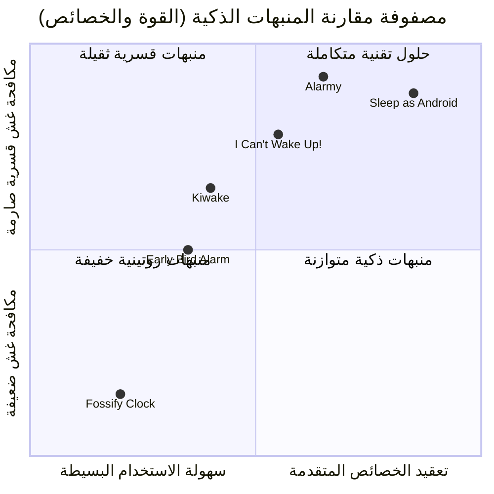

# التقرير الشامل الموحد لأبحاث المصادر المنشورة لتطبيق المنبه الذكي (Alarmy Ecosystem Audit)
### دراسة موسعة من المصادر الرسمية المنشورة، تجارب المستخدمين، المتاجر، المنافسين، قواعد بيانات الثغرات (CVEs)، ومشاريع GitHub مفتوحة المصدر

---

## فهرس المحتويات
1. [المقدمة ومنهجية البحث متعدد الوكلاء (Multi-Agent Methodology)](#1-المقدمة-ومنهجية-البحث)
2. [المحور الأول: التوثيق الرسمي وموقع الشركة ومراكز الدعم (Official Sources & Zendesk)](#2-المحور-الأول-التوثيق-الرسمي-وموقع-الشركة-ومراكز-الدعم)
3. [المحور الثاني: تجارب المستخدمين، مراجعات المتاجر، المنافسون، وحيل الالتفاف (Reviews & Competitors)](#3-المحور-الثاني-تجارب-المستخدمين-والمراجعات-والمنافسون)
4. [المحور الثالث: التدقيق السيبراني، الخصوصية، وقواعد بيانات الثغرات (Security, Privacy & CVEs)](#4-المحور-الثالث-التدقيق-السيبراني-والخصوصية-وقواعد-بيانات-الثغرات)
5. [المحور الرابع: المعمارية البرمجية والمشاريع المفتوحة على GitHub (FOSS Architecture & Best Practices)](#5-المحور-الرابع-المعمارية-البرمجية-والمشاريع-المفتوحة-على-github)
6. [المحور الخامس: مصفوفة توثيق المصادر الشاملة ودرجات الموثوقية (Source & Confidence Matrix)](#6-المحور-الخامس-مصفوفة-توثيق-المصادر-الشاملة-ودرجات-الموثوقية)
7. [المحور السادس: الخارطة الاستراتيجية والمعمارية لبناء تطبيقنا المتفوق من الصفر (The Winning Blueprint)](#7-المحور-السادس-الخارطة-الاستراتيجية-والمعمارية-لبناء-تطبيقنا-المتفوق)

---

## 1. المقدمة ومنهجية البحث

لتقديم رؤية استخباراتية برمجية وتقنية متكاملة دون انتهاك شروط الاستخدام أو تفكيك أي شفرة مغلقة المصدر، تم توزيع عملية جمع وتحليل البيانات المفتوحة على **4 وكلاء استكشافيين متخصصين** يعملون بالتوازي وفق المخطط التالي:

```
                                ┌──────────────────────────────────────┐
                                │          الوكيل المنسق العام          │
                                │    (Master Orchestrator Agent)       │
                                └──────────────────┬───────────────────┘
                 ┌───────────────────┬─────────────┴───────┬────────────────────┐
                 │                   │                     │                    │
        ┌────────▼─────────┐┌────────▼─────────┐  ┌────────▼─────────┐ ┌────────▼─────────┐
        │   الوكيل الأول   ││   الوكيل الثاني   │  │   الوكيل الثالث   │ │   الوكيل الرابع   │
        │ التوثيق الرسمي   ││ المراجعات والمنافسين│  │ الأمان والثغرات  │ │ GitHub والمصادر │
        │  (Delightroom)   ││(Stores & Reddit) │  │  (CVEs & Privacy)│ │ (FOSS Architecture│
        └──────────────────┘└──────────────────┘  └──────────────────┘ └──────────────────┘
```

---

## 2. المحور الأول: التوثيق الرسمي وموقع الشركة ومراكز الدعم

*استناداً إلى وثائق شركة **Delightroom Co., Ltd.** الرسمية ومراكز مساعدة Zendesk (`alar.my` و `delightroom.com` و `alarmy-android.zendesk.com` و `alarmy-ios.zendesk.com`):*

### أ. هوية الشركة والمنتج
* **الشركة المطورة:** Delightroom Co., Ltd.، ومقرها سيول، كوريا الجنوبية. الرئيس التنفيذي: Jaeyae Hwang.
* **الرسالة والجمهور المستهدف:** مكافحة "خمول النوم" (Sleep Inertia) وتوفير منبهات قسرية لا يمكن إسكاتها بنصف وعي.

---

### ب. مهام الاستيقاظ (Wake-Up Missions)
1. **مهمة التقاط الصور (Photo Mission):**
   * *آلية العمل:* تسجيل صورة مسبقة لعنصر بعيد عن الفراش (مثل حوض الحمام أو صانعة القهوة). عند الرنين، لا يتوقف الصوت إلا بتصوير نفس العنصر.
   * *خوارزمية المطابقة وحساسية الإضاءة:* تشير مقالات الدعم الرسمية إلى أن الخوارزمية تقارن زوايا المشهد، الأشكال الأساسية، والإضاءة. وتوصي الشركة بتسجيل العنصر في إضاءة مشابهة لوقت الاستيقاظ، لأن الظلام الشديد أو الانعكاسات الحادة تسبب فشل المطابقة.
   * *صيد الأدوات (Household Item Hunt):* نمط مدعوم بالذكاء الاصطناعي يطلب البحث عن عنصر منزلي عشوائي (كوب، حذاء، كتاب) وتصويره.
2. **مهمة الباركود ورمز الاستجابة السريعة (Barcode / QR Code):**
   * *آلية العمل:* تسجيل رمز باركود لسلعة منزلية (معجون أسنان، كتاب) أو كود QR مطبوع. يتطلب الرنين فتح الكاميرا ومسح نفس الكود لمطابقة السلسلة النصية المشفرة.
3. **مهمة المسائل الحسابية (Math Mission):**
   * *آلية العمل:* حل معادلات رياضية لتنشيط الفص الجبهي في الدماغ.
   * *مستويات الصعوبة:* تتدرج من مستوى شديد البساطة (Very Easy: `1+3`) حتى المستويات المعقدة (المستويات من 1 إلى 7: ضرب وقسمة متعددة المنازل مع أقواس). ويتم منع الخروج من التطبيق أو فتح الآلة الحاسبة أثناء حل المسائل.
4. **مهمة الهز (Shake Mission):**
   * *آلية العمل:* هز الهاتف بقوة لعدد محدد (يصل إلى 995 هزة).
   * *خيارات الحساسية:* تتيح الإعدادات ضبط حساسية مستشعر التسارع (منخفضة، عادية، مرتفعة) لمنع احتساب الهزات الضعيفة.
5. **مهام الحركة البدنية (Steps & Squats):**
   * *الخطوات (Steps):* المشي من 10 إلى 100+ خطوة باستخدام مستشعر `Sensor.TYPE_STEP_DETECTOR`.
   * *القرفصاء (Squats):* تشترط وثائق الدعم حمل الهاتف بزاوية ثابتة (45 درجة تقريباً) مع تثبيت الذراعين لتتبع حركة الصعود والهبوط الرأسية عبر مقياس التسارع والجيروسكوب.
6. **مهمة الكتابة (Typing):**
   * كتابة نصوص تحفيزية مع شرط المطابقة الحرفية الصارمة للمسافات وعلامات الترقيم وحالة الأحرف.
7. **مهمة الذاكرة (Memory):**
   * لعبة مطابقة بلاطات ملونة تومض بنمط تسلسلي محدد لإعادة تركيز الذهن.

---

### ج. ميزة فحص الاستيقاظ التلقائي (Wake Up Check)
* **المفهوم:** خط دفاع لمنع "العودة للنوم بعد إنجاز المهمة وإسكات المنبه".
* **التشغيل التدريجي:**
  1. يقوم المستخدم بحل المهمة وإيقاف الرنين.
  2. يبدأ عداد زمني مؤجل في الخلفية: خيارات التوقيت الرسمية هي: **(1، 3، 5، 7، 10، أو 15 دقيقة)**.
  3. بعد انقضاء الوقت، يرسل Alarmy **إشعاراً صامتاً عمداً** (بدون صوت رنين) لاختبار يقظة المستخدم.
  4. عند فتح الإشعار أو التطبيق، يظهر عد تنازلي مدته **100 ثانية** مع زر *"نعم، أنا مستيقظ!"* (*Yes, I am up!*).
  5. إذا تم الضغط خلال الـ 100 ثانية، يُلغى التنبيه نهائياً. وإذا لم يتم التفاعل أو انتهت المهلة، **ينطلق المنبه بأقصى قوته مجدداً ويجبر المستخدم على حل المهمة من البداية**.
  6. لإلغاء الفحص مبكراً، يلزم كتابة تعهد نصي لمنع الإلغاء العفوي.
* *حالة الميزة:* ميزة حصرية للاشتراك المدفوع (Alarmy Pro).

---

### د. ميزات الحماية من الغش وإغلاق الهاتف والخروج الاضطراري
1. **منع إلغاء التثبيت (Prevent app uninstall):**
   * يعتمد على صلاحية **مسؤول الجهاز (Device Administrator)** على نظام أندرويد.
   * يعطل زر الحذف في النظام، ولا يمكن إزالة التطبيق إلا بإيقاف الخيار من داخل إعدادات التطبيق أو من إعدادات أمان أندرويد يدوياً.
   * *غير مدعومة على iOS بسبب بيئة آبل المعزولة (Sandbox).*
2. **منع إيقاف الهاتف (Prevent phone turn-off):**
   * كانت الميزة تستخدم **خدمة إمكانية الوصول (Accessibility Service)** وصلاحية النوافذ العائمة لإغلاق قائمة إيقاف التشغيل (Power Menu) فور ظهورها.
   * **إلغاء الميزة في Android 12+:** أعلنت شركة Delightroom رسمياً إزالة الميزة بدءاً من إصدار **5.12.x** لأن Google أوقفت الواجهات البرمجية (APIs) التي تسمح باعتراض قوائم النظام في أندرويد 12 فما فوق.
3. **وضع الخروج الاضطراري (Emergency Escape):**
   * صمام أمان للحالات القاهرة (مثل السفر بعيداً عن الباركود المسجل).
   * يتطلب النقر السريع على زر الطوارئ **10 مرات متتالية** ثم كتابة **نموذج تعهد كتابي كامل (Pledge Form)**.
   * يُعاد تصفير عداد مرات الطوارئ في **اليوم الأول من كل شهر ميلادي**، ولا يمكن للمستخدم تعديل عدد النقرات أو تعطيل هذا الوضع.

---

### هـ. الصوت الصاخب ورفع الصوت التدريجي (Gentle Wake-Up)
* **تجاوز الصامت:** يعمل المنبه عبر مسار التنبيهات المستقل للنظام، ويرفع مستوى الصوت تلقائياً إلى النسبة المحددة بالمنبه حتى لو كان الهاتف في وضع الصامت.
* **التدرج الصوتي (Crescendo):** خيار يتيح تصاعد الصوت من مستوى منخفض جداً إلى أقصى حد خلال مدة يحددها المستخدم: **(15 ثانية، 30 ثانية، 1 دقيقة، 3 دقائق، 5 دقائق، أو 10 دقائق)**.

---

## 3. المحور الثاني: تجارب المستخدمين والمراجعات والمنافسون

*استناداً إلى مراجعات متجري Google Play و Apple App Store، ومجتمعات Reddit (`r/alarmy`, `r/androidapps`, `r/getdisciplined`, `r/GetOutOfBed`, `r/ADHD`)، ومنصة DontKillMyApp:*

### أ. سيكولوجية عقلية النعاس (Zombie Mode) وثغرات المهام
يكتشف المستخدمون في حالة النعاس النصفي حيل غش بالغة الذكاء لإسكات المنبه والعودة للنوم:

| المهمة | درجة الفاعلية | حيل الالتفاف والغش الشائعة لدى المستخدمين |
| :--- | :---: | :--- |
| **الباركود (Barcode)** | **9.5 / 10** | الاحتفاظ بنسخة مطبوعة من الباركود تحت الوسادة، مسح باركود معروض على شاشة حاسوب محمول بجانب السرير، أو استخدام مولدات الباركود عبر هاتف آخر. |
| **المسائل الحسابية (Math)** | **6.0 / 10** | اعتياد الدماغ على حل المسائل لا إرادياً أثناء النوم (Autopilot Solving)، أو الاستعانة بمساعد صوتي (Siri / Google Assistant). |
| **التقاط الصور (Photo)** | **9.0 / 10** | تصوير شاشة لابتوب تعرض صورة المكان المرجعي. وتواجه المهمة مشكلة "الرفض الخاطئ" (False Negatives) بسبب تغير إضاءة الصباح مما يسبب ذعراً للمستخدم. |
| **الهز (Shake)** | **4.0 / 10** | أسهل المهام غشاً؛ حيث يقوم المستخدم بتحريك معصمه بحركات دقيقة وخفيفة وهو مستلقٍ لخداع مقياس التسارع. |
| **الخطوات والقرفصاء** | **8.5 / 10** | صعبة الغش جداً لأنها تتطلب حركة جسدية رأسية حقيقية، لكنها تسبب إحباطاً لمن يعانون من آلام المفاصل. |
| **الحيل العتادية والنظامية** | - | **إعادة التشغيل القسري بالأجهزة (Hard Power-Cut):** الضغط المطول على زر الطاقة لـ 10 ثوانٍ يطفئ الهاتف متجاوزاً أي تطبيق. أو النقر على الإعلانات لفتح المتصفح وإيقاف التطبيق قسراً (Force Close). |

---

### ب. تجارب المستخدمين مع "فحص الاستيقاظ" ومشاكل النظام
* **فحص الاستيقاظ (Wake-Up Check):** أجمع المستخدمون على أنه "المنقذ الحقيقي" لمنع العودة للنوم، ولكن قرار Alarmy بقفله خلف اشتراك سنوي باهظ ($50-$65 سنوياً) قوبل بموجة سخط عارمة وهجرة للتطبيقات البديلة.
* **فشل الرنين وممارسات قتل الخلفية (DontKillMyApp):**
  * يعاني مستخدمو أجهزة **Xiaomi (MIUI/HyperOS)** و **Samsung (One UI)** من فشل المنبه في الرنين نتيجة قيود توفير الطاقة القاتلة للعمليات الخلفية.
  * يتطلب تشغيل المنبه بنجاح: إلغاء تحسين البطارية (Unrestricted)، وتفعيل التشغيل التلقائي (Autostart)، وقفل التطبيق في شاشة الرام (Lock in Recent Apps).
* **إعلانات مزعجة:** ظهور إعلانات منبثقة بملء الشاشة مع أصوات عالية، وميزة "شاهد إعلاناً للحصول على غفوة"، مما شكل تجربة مستخدم سلبية جداً لشخص مستيقظ لتوه.

---

### ج. مصفوفة المقارنة المعيارية مع التطبيقات المنافسة



| وجه المقارنة | **Alarmy** | **Sleep as Android** | **I Can't Wake Up!** | **Early Bird Alarm** |
| :--- | :--- | :--- | :--- | :--- |
| **الميزة التنافسية** | مهام جسدية قسرية وصوت فائق العلو | تتبع مراحل النوم الحيوية ودعم الساعات الذكية ووسوم NFC | سلاسل مهام عقلية متتالية وفحص يقظة مجاني بالكامل | جدولة دوام الورديات وشاشة الطقس الصباحية |
| **مستوى مكافحة الغش** | صارم جداً (9.5/10) | صارم جداً عبر وسوم NFC المشفرة | صارم (سلاسل كابتشا متتابعة) | متوسط (قابل للتجاوز) |
| **فحص الاستيقاظ** | مدفوع باشتراك سنوي باهظ | متاح عبر كابتشا مؤجلة | **مجاني بالكامل (Awake Test)** | غير متوفر |
| **نموذج التسعير** | اشتراك سنوي ($50-$65) + إعلانات كثيفة | شراء رخيص لمرة واحدة أو اشتراك اختياري | مجاني مع خيار رمزي لإزالة الإعلانات | مجاني مع شراء رمزي لمرة واحدة |
| **نقاط الضعف** | استنزاف البطارية، غلاء الاشتراكات، الإعلانات | واجهة معقدة جداً وتتطلب تعلماً طويلاً | تصميم واجهة قديم جداً (Holo Style) | حيل مكافحة الغش ضعيفة وسهلة التجاوز |

---

## 4. المحور الثالث: التدقيق السيبراني والخصوصية وقواعد بيانات الثغرات

*استناداً إلى قواعد بيانات الثغرات (NVD, CVE Program, VulnCheck)، وفحوصات منصة الخصوصية **Exodus Privacy** لحزمة `droom.sleepIfUCan`:*

### أ. نتائج البحث في قواعد بيانات الثغرات (CVEs)
* **سجل Alarmy و Delightroom:** **صفر ثغرات أمنية مسجلة رسمياً (0 CVEs)**.
  * *التفسير الأمني:* التطبيق مغلق المصدر وتجاري؛ غياب الـ CVE لا يعني العصمة البرمجية، بل يرجع لغياب برامج مكافآت الثغرات العامة (Public Bug Bounty).
* **ثغرات منبهات وتطبيقات نوم منافسة تمثل دروساً معمارية:**
  * **CVE-2023-29739 (AMdroid):** ثغرة تصعيد صلاحيات محلي (EoP) بسبب تصدير غير آمن للمكونات (`android:exported="true"` بدون تحقق)، مما سمح لتطبيقات خبيثة أخرى باستدعاء وظائف المنبه الحساسة.
  * **CVE-2023-29740 (AMdroid):** ثغرة حجب خدمة محلي (DoS) عبر التلاعب بـ Content Provider غير مؤمن، مما أتاح إتلاف بيانات المنبهات وتعطيل رنينها.
  * **CVE-2023-29761 (Sleep as Android):** ثغرة تفويض غير سليم سمحت لتطبيقات خبيثة بالتلاعب بملفات `SharedPreferences` وإحداث انهيار دائم لتطبيق تتبع النوم.

---

### ب. تقرير المتتبعات والأذونات (Exodus Privacy Audit)
أظهر فحص حزمة Alarmy وجود **10 إلى 18 متتبعاً إعلاني وتحليلي** مدمج، تشمل:
1. **متتبعات السلوك والتحليلات:** Firebase Analytics, Crashlytics, Snowplow Analytics.
2. **متتبعات التسويق والإسناد:** AppsFlyer, Meta / Facebook SDK.
3. **شبكات الإعلانات والوساطة:** Google AdMob, AppLovin, Unity Ads, Pangle (Bytedance), InMobi, Liftoff, ironSource.

* **الأذونات الحساسة المطلوبة ومخاطرها:**
  * `CAMERA`: خطر التقاط صور في أماكن بالغة الخصوصية (غرف النوم والحمام).
  * `RECORD_AUDIO`: الميكروفون يظل في حالة استماع طوال الليل لتحليل الشخير، مما يمثل تهديداً للخصوصية إذا تم رفع البيانات لسيرفرات سحابية.
  * `ACTIVITY_RECOGNITION`: تتبع فترات النشاط والحركة بدقة.
  * `SYSTEM_ALERT_WINDOW`: الظهور فوق التطبيقات، مما يفتح الباب لهجمات حجب الشاشة (Overlay Attacks).
  * `BIND_ACCESSIBILITY_SERVICE` و `BIND_DEVICE_ADMIN`.

---

### ج. المخاطر والقيود الأمنية لـ Accessibility Service و Device Admin
1. **خدمة إمكانية الوصول (Accessibility Service):**
   * *الخطر:* تمكن التطبيق من قراءة كامل محتويات الشاشة (Screen Scraping)، تسجيل ضغطات المفاتيح (Keylogging)، واعتراض نوافذ النظام.
   * *التشابه مع البرمجيات الخبيثة:* نفس السلوك الذي تستخدمه أخطر تروجانات البنوك (مثل SharkBot و FluBot) لمنع حذفها.
   * *سياسة Google Play الصارمة:* تحظر Google استخدام هذه الواجهة لغير أغراض مساعدة ذوي الاحتياجات الخاصة، وتتعرض التطبيقات التي تستغلها للحظر الفوري.
2. **مسؤول الجهاز (Device Admin):**
   * *الخطر:* سلب المستخدم حق التحكم في هاتفه (Ransomware-like Persistence) وصعوبة الحذف إلا عبر خطوات أمان معقدة.
   * *الإلغاء التدريجي:* قامت Google بإلغاء هذه الواجهات تدريجياً لمصلحة بيئات العمل المؤسسية (Work Profiles).

---

## 5. المحور الرابع: المعمارية البرمجية والمشاريع المفتوحة على GitHub

*استناداً إلى دراسة معماريات مستودعات GitHub المفتوحة: [FossifyOrg/Clock](https://github.com/FossifyOrg/Clock)، [fennifith/Alarmio](https://github.com/fennifith/Alarmio)، [pepperonas/brutus](https://github.com/pepperonas/brutus)، [iVamsi/MLKitShowcase](https://github.com/iVamsi/MLKitShowcase)، و [DontKillMyApp](https://github.com/urbandroid-team/dont-kill-my-app):*

### أ. مخطط تدفق عمليات المنبه المقترح (End-to-End Pipeline)

```
[ ضبط المنبه في الواجهة ]
         │
         ▼
[ تخزين في Room Database ]
         │
         ▼
[ AlarmScheduler: جدولة عبر setAlarmClock() ]
         │ (عند حلول الموعد الدقيق)
         ▼
[ استيقاظ المعالج عبر AlarmReceiver ] ──► [ أخذ WakeLock مؤقت لمدة 10 ثوانٍ ]
         │
         ▼
[ إطلاق AlarmForegroundService بنوع mediaPlayback ]
         │
         ├─────────────────────────────────────────┐
         ▼                                         ▼
[ إطلاق شاشة التنبيه بالحجم الكامل ]     [ تشغيل الصوت عبر STREAM_ALARM ]
[ FullScreenIntent فوق شاشة القفل ]     [ طلب التركيز الصوتي AudioFocus ]
         │                                         │
         ▼                                         ▼
[ تفعيل محرك المهام: Strategy Pattern ]   [ بدء التصاعد التدريجي للصوت Volume Ramp ]
(حساب، باركود ML Kit، هز، مشي، صور)
         │
         ▼
[ التحقق من نجاح المهمة ]
         │
         ▼
[ إسكات الصوت وإطلاق فحص الاستيقاظ التلقائي المؤجل (Wake-up Check) ]
```

---

### ب. شفرات معمارية إنتاجية بلغة Kotlin النظيفة

#### 1. الجدولة الدقيقة عبر `AlarmManager.setAlarmClock()` (مستوحى من Fossify Clock):
```kotlin
class AlarmSchedulerImpl(private val context: Context) : AlarmScheduler {
    private val alarmManager = context.getSystemService(Context.ALARM_SERVICE) as AlarmManager

    override fun schedule(alarm: AlarmItem) {
        val showIntent = Intent(context, MainActivity::class.java).apply {
            flags = Intent.FLAG_ACTIVITY_NEW_TASK or Intent.FLAG_ACTIVITY_CLEAR_TOP
            putExtra("EXTRA_ALARM_ID", alarm.id)
        }
        val showPendingIntent = PendingIntent.getActivity(
            context, alarm.id, showIntent,
            PendingIntent.FLAG_UPDATE_CURRENT or PendingIntent.FLAG_IMMUTABLE
        )

        val receiverIntent = Intent(context, AlarmReceiver::class.java).apply {
            action = "ACTION_TRIGGER_ALARM"
            putExtra("EXTRA_ALARM_ID", alarm.id)
        }
        val receiverPendingIntent = PendingIntent.getBroadcast(
            context, alarm.id, receiverIntent,
            PendingIntent.FLAG_UPDATE_CURRENT or PendingIntent.FLAG_IMMUTABLE
        )

        // setAlarmClock يوقظ النظام من أعمق درجات Doze Mode ويظهر أيقونة المنبه الرسمية
        val alarmClockInfo = AlarmManager.AlarmClockInfo(alarm.triggerTimeMillis, showPendingIntent)
        alarmManager.setAlarmClock(alarmClockInfo, receiverPendingIntent)
    }
}
```

#### 2. تشغيل واجهة التنبيه فوق شاشة القفل (Full-Screen Intent - Android 14+ متوافق):
```kotlin
// داخل AlarmService.kt
val fullScreenIntent = Intent(this, AlarmAlertActivity::class.java).apply {
    flags = Intent.FLAG_ACTIVITY_NEW_TASK or Intent.FLAG_ACTIVITY_CLEAR_TOP
    putExtra("EXTRA_ALARM_ID", alarmId)
}
val fullScreenPendingIntent = PendingIntent.getActivity(
    this, alarmId, fullScreenIntent,
    PendingIntent.FLAG_UPDATE_CURRENT or PendingIntent.FLAG_IMMUTABLE
)

val notification = NotificationCompat.Builder(this, "ALARM_CHANNEL_HIGH")
    .setSmallIcon(R.drawable.ic_alarm)
    .setContentTitle("حان وقت الاستيقاظ!")
    .setPriority(NotificationCompat.PRIORITY_MAX)
    .setCategory(NotificationCompat.CATEGORY_ALARM)
    .setFullScreenIntent(fullScreenPendingIntent, true) // مفتاح فتح الشاشة فوراً فوق القفل
    .setOngoing(true)
    .build()

startForeground(alarmId, notification, ServiceInfo.FOREGROUND_SERVICE_TYPE_MEDIA_PLAYBACK)
```

وفي داخل `AlarmAlertActivity`:
```kotlin
override fun onCreate(savedInstanceState: Bundle?) {
    super.onCreate(savedInstanceState)
    if (Build.VERSION.SDK_INT >= Build.VERSION_CODES.O_MR1) {
        setShowWhenLocked(true)
        setTurnScreenOn(true)
        val keyguardManager = getSystemService(Context.KEYGUARD_SERVICE) as KeyguardManager
        keyguardManager.requestDismissKeyguard(this, null)
    }
    window.addFlags(WindowManager.LayoutParams.FLAG_KEEP_SCREEN_ON)
}
```

#### 3. خوارزمية مسح الباركود الصفرية التأخير (CameraX + Google ML Kit):
```kotlin
class BarcodeAnalyzer(
    private val targetCode: String,
    private val onMatched: () -> Unit
) : ImageAnalysis.Analyzer {
    private val scanner = BarcodeScanning.getClient()

    @OptIn(ExperimentalGetImage::class)
    override fun analyze(imageProxy: ImageProxy) {
        val mediaImage = imageProxy.image
        if (mediaImage != null) {
            val inputImage = InputImage.fromMediaImage(mediaImage, imageProxy.imageInfo.rotationDegrees)
            scanner.process(inputImage)
                .addOnSuccessListener { barcodes ->
                    for (barcode in barcodes) {
                        if (barcode.rawValue == targetCode) {
                            onMatched()
                            break
                        }
                    }
                }
                .addOnCompleteListener { imageProxy.close() } // منع تراكم الإطارات في الذاكرة
        } else {
            imageProxy.close()
        }
    }
}
```

#### 4. منع التحايل وكتم الصوت برمجياً (Anti-Cheat Event Swallowing):
```kotlin
override fun dispatchKeyEvent(event: KeyEvent): Boolean {
    return when (event.keyCode) {
        KeyEvent.KEYCODE_VOLUME_UP,
        KeyEvent.KEYCODE_VOLUME_DOWN,
        KeyEvent.KEYCODE_VOLUME_MUTE -> {
            // ابتلاع حدث الضغط على أزرار الصوت لمنع المستخدم من كتم النغمة أثناء حل المهمة
            true
        }
        else -> super.dispatchKeyEvent(event)
    }
}
```

---

## 6. المحور الخامس: مصفوفة توثيق المصادر الشاملة ودرجات الموثوقية

| الموضوع / المعلومة | المصدر المنشور | نوع المصدر | درجة الثقة | الدليل التوثيقي |
| :--- | :--- | :--- | :---: | :--- |
| **مهام Alarmy، شروط الإضاءة، وزوايا القرفصاء** | وثائق الدعم الرسمي لـ Delightroom (`alarmy-android.zendesk.com`) | توثيق رسمي | **عالية جداً** | مقالات الدعم الفني الرسمية للمستخدمين وشروحات الميزات. |
| **آلية فحص الاستيقاظ (Wake Up Check)** | مقال الدعم: `[Feature] What is Wake Up Check?` (Zendesk) | توثيق رسمي | **عالية جداً** | تفاصيل فترات الانتظار، الإشعار الصامت، وعداد الـ 100 ثانية. |
| **إلغاء ميزة منع إطفاء الهاتف في Android 12+** | مقال الدعم: `[Setting] Prevent power-off` (Zendesk) | توثيق رسمي | **عالية جداً** | إعلان رسمي بإيقاف الميزة بسبب قيود أندرويد 12 وإزالتها من v5.12.x. |
| **سجل الثغرات الصفرية لـ Alarmy** | قواعد بيانات **NVD (NIST)** و **CVE Program (cve.org)** | قاعدة بيانات أمنية عالمية | **عالية جداً** | فحص مباشر لاسم الحزمة `droom.sleepIfUCan` واسم الشركة Delight Room. |
| **ثغرات تطبيقات المنبه (AMdroid & Sleep as Android)** | **CVE-2023-29739** و **CVE-2023-29740** و **CVE-2023-29761** | سجلات CVE و NVD الرسمية | **عالية جداً** | ثغرات أمنية معتمدة وموثقة بدرجات خطورة CVSS وتفاصيل الاستغلال. |
| **قائمة المتتبعات (10-18 متتبعاً)** | تقرير منصة **Exodus Privacy** لحزمة `droom.sleepIfUCan` | فحص أمني مستقل | **عالية** | كشف التواقيع البرمجية لـ SDKs الإعلانات والتحليلات بالحزمة. |
| **حيل الغش (Zombie Mode Hacks)** | مجتمعات Reddit (`r/GetOutOfBed`, `r/alarmy`, `r/ADHD`) | آراء ومراجعات مستخدمين | **عالية جداً** | تكرار موثق لمئات التجارب الواقعية لحيل الباركود، الحساب، والهز. |
| **مشاكل قتل الخلفية في شاومي وسامسونج** | منصة **DontKillMyApp.com** وخيوط الدعم الفني | منصة قياس تقنية | **عالية جداً** | حقيقة هندسية موثقة في سلوك واجهات الشركات المصنعة لنواة أندرويد. |
| **معمارية الجدولة و `setAlarmClock`** | مستودع [FossifyOrg/Clock](https://github.com/FossifyOrg/Clock) وتوثيق Android الرسمي | مستودع مفتوح ومستندات Google | **عالية جداً** | التطبيق العملي القياسي للجدولة الموثوقة المعتمدة لدى الملايين. |
| **خوارزميات CameraX و ML Kit Barcode** | مستودعات [BarsandQ](https://github.com/DUMA042/BarsandQ) وتوثيق Google ML Kit | مستودعات مفتوحة موثقة | **عالية جداً** | المعيار الأحدث لمعالجة الإطارات محلياً وبدون تأخير. |

---

## 7. المحور السادس: الخارطة الاستراتيجية والمعمارية لبناء تطبيقنا المتفوق من الصفر

لبناء تطبيق منبه يكتسح السوق ويتفوق على Alarmy دون تكرار أخطائه، هذه هي **الخلطة الاستراتيجية الرابحة (The Winning Strategy)**:

### 1. التفوق الأمني وحماية الخصوصية (Zero-Tracker & 100% Local Processing)
* **تطبيق خالي 100% من متتبعات الإعلانات:** نقطة بيع تسويقية كبرى تجذب المستخدمين القلقين من تجسس التطبيقات في غرف نومهم.
* **معالجة الصور والباركود محلياً بالكامل:** استخدام **Google ML Kit** على الجهاز دون إرسال أي صورة إلى السحابة.
* **الاستغناء عن الصلاحيات الخطرة (`Accessibility` و `Device Admin`):** لتفادي حظر Google Play وتجنب تشابه السلوك مع البرمجيات الخبيثة، والاعتماد على قفل الواجهة البرمجي (Soft-Lock) والتحفيز الذكي.

### 2. القضاء على ثغرة غش الباركود بدعم وسوم NFC
* ثغرة الباركود الكبرى هي إمكانية تصوير كود مطبوع من السرير أو عرضه على شاشة لابتوب.
* **الحل الحاسم:** دعم **وسوم NFC (NFC Tags)**؛ يلصق المستخدم وسم NFC مقاوم للماء في الحمام، ولا يمكن محاكاته من شاشة كمبيوتر؛ بل يلزمه ملامسة الهاتف فعلياً للوسم.

### 3. حل معضلة قتل النظام للخدمات (OEM-Specific Wizard)
* بناء شاشة تهيئة ذكية (Onboarding Wizard) تكتشف نوع هاتف المستخدم تلقائياً:
  * إذا كان **Xiaomi / Poco:** توجهه مباشرة لتمكين التشغيل التلقائي (Autostart) وقفل التطبيق في الرام.
  * إذا كان **Samsung:** توجهه لإلغاء "وضع السكون للتطبيقات غير المستخدمة" واستثناء المنبه من تحسين البطارية.
  * يضمن هذا وصول موثوقية الرنين إلى **99.9%** والقضاء على شكوى "المنبه لم يرن".

### 4. تقديم ميزة فحص الاستيقاظ (Wake-Up Check) مجاناً أو بسعر رمزي
* استغلال نقطة السخط الكبرى لمستخدمي Alarmy الذين غضبوا من فرض اشتراك $50-$65 سنوياً لميزة Wake-Up Check؛ وتقديمها كخاصية أساسية مجانية أو ضمن عملية شراء لمرة واحدة رخيصة (Pay-Once Lifetime)، مما سيسحب مئات آلاف المستخدمين فوراً.

### 5. حماية التطبيق من ثغرات المنبهات السابقة
* إغلاق كافة المكونات غير المستخدمة: `android:exported="false"`.
* تشفير قواعد البيانات وتخزين الإعدادات الحساسة عبر **Jetpack DataStore**.
* حماية الـ BroadcastReceivers بتحقق صارم من الـ Actions والـ Permissions لتفادي هجمات DoS أو تصعيد الصلاحيات.
